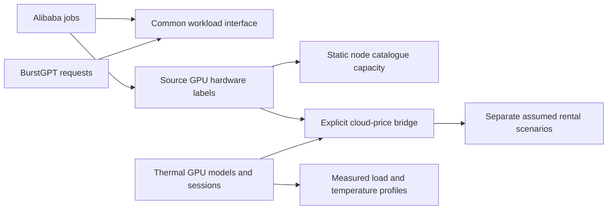
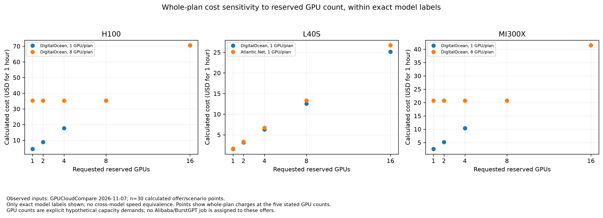
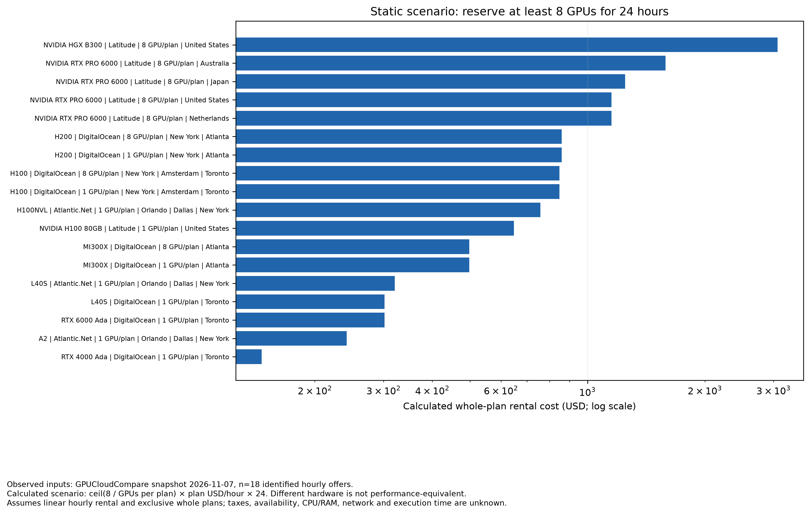
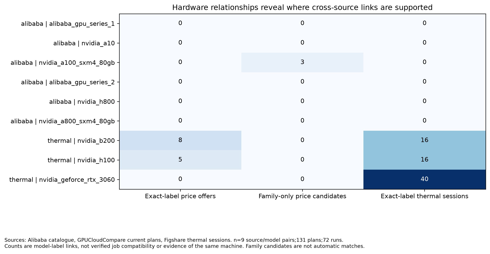
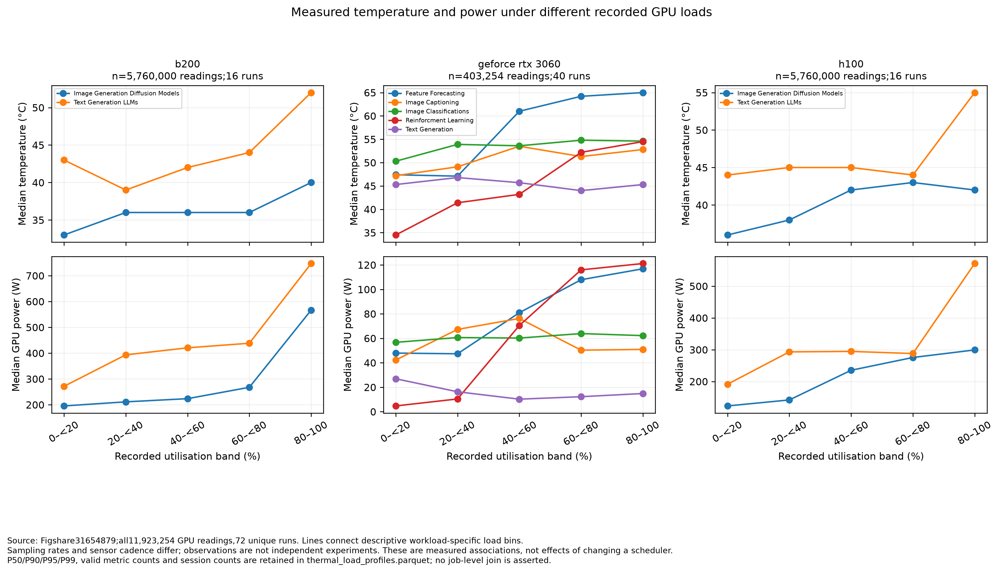
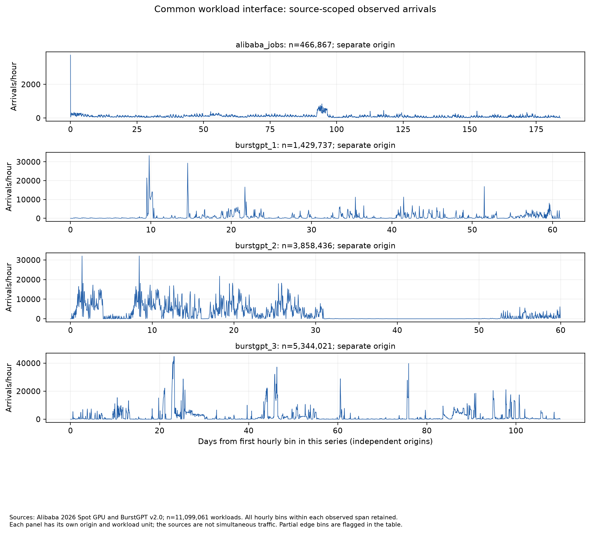
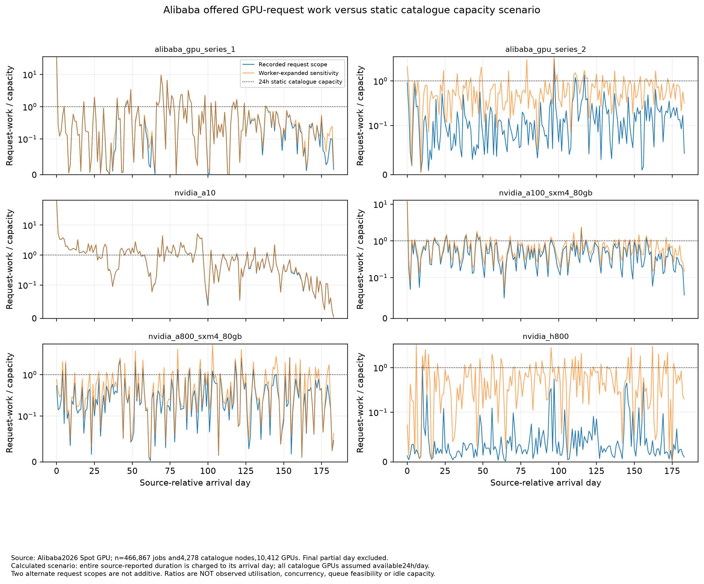
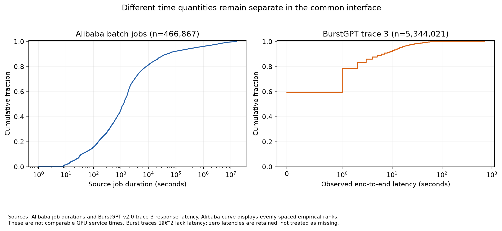

# Unified GPU analytical layer

All four sources are available through a common workload view, explicit model-level bridges
and separately labelled scenario tables. The original harmonised tables are intact.
No model, scheduler, scheduling simulator or frontend was built.

## Delivered structure

- `integrated/workloads/`: 11,099,061 observed events with a common schema,
  including 466,867 Alibaba jobs and 10,632,194 BurstGPT requests. Workload type, source time
  origin, original fields and missing information remain explicit.
- `integrated/workload_hourly.parquet`: source-scoped arrival and demand summaries.
- `integrated/hardware/`: hardware vocabulary, pricing and thermal links, static catalogue
  capacity and observed thermal-load profiles.
- `integrated/scenarios/`: explicit rental assumptions, calculated costs and missing job-price coverage.

There are 65 new readable Parquet files and 7
PNG/PDF graph pairs. Hash comparisons confirm that all 210
original harmonised Parquet files are unchanged. Source checks reconcile workload rows, linked
records and rental arithmetic. PNG integrity and PDF existence were checked; PDFs were not
independently rendered.

## How the sources relate

Arrows show analytical relationships, not evidence that records describe the same machine.
BurstGPT has no GPU identity and therefore no observed hardware-price or thermal join.
The pricing bridge retains unavailable and family-only matches. H100 and B200 thermal labels
have descriptive price links; Alibaba A100-SXM4-80GB has generic A100 candidates only.

## Observed, calculated and assumed

Observed events, sensor measurements and source catalogue prices retain source references.
Counts, conditional percentiles and request-duration proxies are calculations from those
observations. Static node capacity is not time-varying available capacity. Request-work
versus catalogue-capacity comparisons do not measure concurrency, idle GPUs or utilisation.

Rental scenarios specify GPU count and elapsed rental hours. Cost uses whole-plan rounding
and listed USD/hour prices. They do not estimate actual Alibaba or BurstGPT costs, transfer
runtime across hardware, or convert end-to-end request latency into GPU service time.

## Source-specific findings and assumptions

## Unified workload layer

Verified: all466,867 Alibaba jobs and10,632,194 canonical BurstGPT requests are represented once in an identical common schema, for11,099,061 records. Original source strings are retained in separate nullable structs, alongside source table/row references. Different clocks, workload types, job duration and completion latency remain explicitly distinct.

The source-scoped arrival graph shows bursts and changing traffic volumes without assuming simultaneous operation. The time-quantity graph deliberately separates Alibaba job duration from BurstGPT completion latency. Missing GPU identity and resource demand for inference remain null, so the common interface does not invent GPU-hours per token or a placement target. Hardware/cost scenarios require separately declared assumptions rather than a record-level join.

No original harmonised tables changed. All output files were read back and compared with their constructed Arrow tables; counts and hourly aggregates reconcile. No ML/RL model, scheduler, simulator or frontend was built.

## Cross-source hardware relationships

Verified: 26 named GPU identifiers, 22 origin-to-price rows and 104 model-to-thermal-session links.
Alibaba's A100-SXM4-80GB has generic A100 family price candidates only, not a confirmed exact variant match. Other Alibaba models have no supported cloud price match in these sources. Do not use candidate prices as measured job costs.
Thermal H100 and B200 have exact model-label pricing records; RTX3060 has no price match. H100 memory/interconnect variants remain distinct. No link establishes physical-device identity or full functional compatibility.

All 11,923,254 thermal GPU readings were used. They produce 45 workload/model/load-band profiles with observed P50/P90/P95/P99 temperature and power, valid counts and distinct session counts. These are experimental load associations, not measured effects of a scheduling policy.
Figures: `hardware_link_coverage` makes missing links visible; `hardware_thermal_load_profiles` compares recorded temperature and power across utilisation bands while preserving hardware and workload strata. Sources and counts are stated on each figure.
Raw timestamps are not aligned across datasets. Static Alibaba catalogue capacity does not describe maintenance, reservations or available GPUs over time. Additional performance and resource-compatibility evidence is needed before hardware substitution decisions.

## Calculated cloud-rental scenarios

Observed inputs: 131 current plan records, 393 billing/currency slots; 18 identified hourly USD offers
have positive stated GPU counts. The source snapshot date is 7 November 2026. All source plan IDs and the
offers Parquet SHA256 are retained.

Calculated outcomes: 180 static cases cover requested counts 1, 2, 4, 8 and 16 GPUs and rental windows
1 and 24 hours. Cost = ceil(required GPU count / GPUs per plan) × listed hourly plan price × hours.
The whole plan is charged even when capacity is unused. These are arithmetic rental cases, not simulated
or observed scheduling outcomes. They do not imply equal workload performance across hardware.

For the 8-GPU/24-hour scenario, listed-offer rental estimates range from USD 145.92
to USD 3,072.00. This mixes GPU models and is not a cost-effectiveness ranking.
The demand sensitivity graph separates H100, L40S and MI300X exact source model labels.

Alibaba has 6 hardware labels covering 466,867 jobs, with no exact identifier match to the
eligible hourly offers. Generic A100 prices cannot establish compatibility with A100-SXM4-80GB jobs.
Actual Alibaba cloud job costs remain null. BurstGPT has no recorded GPU model or GPU service time;
its end-to-end elapsed time is not used as GPU rental time. No cost per request/token is invented.

Limitations: linear hourly billing is assumed because minimum billing periods/rounding are not supplied.
CPU/RAM/disk feasibility, region availability, interconnect, taxes, egress, setup time, discounts and workload
performance are unmodelled. No monthly-to-hourly or currency conversion is performed. Runtime under
another hardware configuration would require separate evidence.

Source/attribution: GPU Cloud Price Index, https://gpucloudcompare.com/data/, CC-BY-4.0. Alibaba source
licence coverage remains unresolved as documented in Phase 1. Existing harmonised tables remain unchanged.
Reproduce: `python scripts/integrated/costs.py`.

## Integrated graphs

Each graph labels its sources, units, counts and assumptions.

### Calculated rental cost as required GPU count changes within exact cloud model labels.

[PDF](figures/costs_demand_sensitivity.pdf)

### Calculated whole-plan rental costs for explicit GPU-count and rental-hour scenarios.

[PDF](figures/costs_rental_scenarios.pdf)

### Hardware links and gaps across workload, cloud-price and thermal sources.

[PDF](figures/hardware_link_coverage.pdf)

### Measured temperature and power distributions under different recorded GPU loads.

[PDF](figures/hardware_thermal_load_profiles.pdf)

### Source-scoped batch and inference arrivals, with separate clocks and workload types.

[PDF](figures/workloads_arrivals.pdf)

### Calculated offered-work proxies versus a stated static catalogue-capacity scenario.

[PDF](figures/workloads_demand_capacity.pdf)

### Job duration and request completion latency, shown as different measured quantities.

[PDF](figures/workloads_time_quantities.pdf)

## What can be examined now

Compare batch and inference arrival patterns within their own observed periods. Inspect
priority differences, recorded requests and offered-work proxies against a stated static
capacity assumption. Compare whole-plan rental costs for explicit resource requirements.
Inspect measured thermal and power distributions within hardware/workload/load groups.

These comparisons do not establish better scheduling policies, future prediction accuracy,
cross-hardware execution performance, actual cloud placement feasibility or thermal causality.
No unrelated job is assigned an experimental temperature or cloud bill.

## Dictionary, validation and reproduction

- [Dictionary and precise relationships](data-dictionary.md)
- [Validation results and table schemas](validation.json)
- [Analytical-layer guide](../../integrated/README.md)

Run `python scripts/integrated/run.py` from the repository root with the pinned Phase 1
dependencies. It reads existing local harmonised tables and writes only the new layer and
its analysis artefacts. Source licences remain separate: preserve BurstGPT and pricing
attribution; Alibaba licence coverage and the thermal archive/metadata licence conflict
remain unresolved as documented in Phase 1. The private repository does not resolve them.
